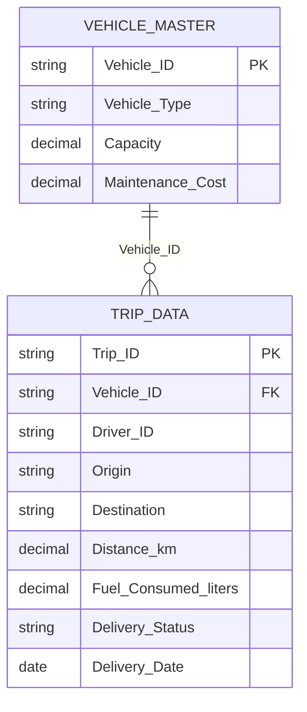

# 🚚 Fleet Performance & Delivery Efficiency Dashboard

## 📋 Table of Contents
- [Project Overview](#-project-overview)
- [Data Structure](#-data-structure--schema)
- [Data Cleaning](#-data-cleaning--preparation)
- [Data Modeling](#-data-modeling)
- [DAX Measures](#-dax-measures)
- [Dashboard Pages](#-dashboard-visualizations)
- [AI Analytics](#-ai-powered-analytics)
- [Business Insights](#-business-insights--recommendations)
- [Project Outcome](#-project-outcome)

---

## 🔍 Project Overview

The Fleet Performance & Delivery Efficiency Dashboard is an interactive Power BI project designed to monitor logistics operations, delivery reliability, fuel efficiency, and estimated transportation costs.

- **Tool:** Microsoft Power BI Desktop
- **Data Source:** `logistics_project_dataset.xlsx`
- **Data Preparation:** Power Query
- **Analytics:** DAX and AI-assisted visuals
- **Model:** Simplified star schema

### Business Objectives
- Monitor on-time delivery performance.
- Analyze fuel efficiency by vehicle and route.
- Identify high-cost routes and destinations.
- Evaluate fleet maintenance expenditure.
- Investigate factors associated with delivery delays.
- Support data-driven operational decisions.

---

## 🗄️ Data Structure & Schema

### 1. `Trip_Data` — Fact Table

| Column | Data Type | Description |
|---|---|---|
| `Trip_ID` | Text | Unique trip identifier |
| `Vehicle_ID` | Text | Vehicle foreign key |
| `Driver_ID` | Text | Assigned driver |
| `Origin` | Text | Starting location |
| `Destination` | Text | Delivery destination |
| `Distance_km` | Decimal | Distance travelled |
| `Fuel_Consumed_liters` | Decimal | Fuel consumed |
| `Delivery_Status` | Text | On-Time or Late |
| `Delivery_Date` | Date | Delivery date |

### 2. `Vehicle_Master` — Dimension Table

| Column | Data Type | Description |
|---|---|---|
| `Vehicle_ID` | Text | Unique vehicle key |
| `Vehicle_Type` | Text | Truck, Van, or Mini-Truck |
| `Capacity` | Decimal | Maximum vehicle capacity |
| `Maintenance_Cost` | Currency | Recorded maintenance expenditure |

Validate that `Trip_ID` is unique at the trip grain and `Vehicle_Master[Vehicle_ID]` contains unique values.

---

## 🧹 Data Cleaning & Preparation

Performed in Power Query:

1. Set correct data types for dates, distances, fuel, capacity, and costs.
2. Trim and clean text columns.
3. Standardize delivery statuses, vehicle types, and location names.
4. Check duplicate trip IDs and vehicle IDs.
5. Investigate missing fuel values before deciding whether to exclude or impute them.
6. Flag negative distances, negative fuel consumption, and invalid statuses.
7. Reconcile row counts and totals against the source Excel file.

**Data quality rule:** Never replace missing fuel values with zero or the mean without assessing how the replacement affects fuel efficiency.

---

## 🔗 Data Modeling

### Relationship Diagram



### Relationship Configuration

| Setting | Configuration |
|---|---|
| Dimension | `Vehicle_Master` |
| Fact table | `Trip_Data` |
| Join columns | `Vehicle_ID` |
| Cardinality | One-to-many (1:*) |
| Filter direction | Single |
| Relationship | Active |

The diagram assumes each trip has one `Trip_ID` and each vehicle has one unique master record. If the source has multiple rows per trip, define the correct grain before using these measures.

### Recommended Calendar Table

```dax
Calendar =
ADDCOLUMNS(
    CALENDAR(
        MIN(Trip_Data[Delivery_Date]),
        MAX(Trip_Data[Delivery_Date])
    ),
    "Year", YEAR([Date]),
    "Month Number", MONTH([Date]),
    "Month", FORMAT([Date], "MMM"),
    "Year-Month", FORMAT([Date], "YYYY-MM")
)
```

Mark `Calendar` as the date table and create an active one-to-many relationship from `Calendar[Date]` to `Trip_Data[Delivery_Date]`. Sort `Calendar[Month]` by `Calendar[Month Number]`.

---

## 📐 DAX Measures

### 1. Total Trips

```dax
Total Trips =
DISTINCTCOUNT(Trip_Data[Trip_ID])
```

### 2. On-Time Trips

```dax
On-Time Trips =
CALCULATE(
    [Total Trips],
    Trip_Data[Delivery_Status] = "On-Time"
)
```

### 3. On-Time Delivery %

```dax
On-Time Delivery % =
DIVIDE([On-Time Trips], [Total Trips], 0)
```
Format as Percentage.

### 4. Late Trips

```dax
Late Trips =
CALCULATE(
    [Total Trips],
    Trip_Data[Delivery_Status] = "Late"
)
```

### 5. Late Delivery %

```dax
Late Delivery % =
DIVIDE([Late Trips], [Total Trips], 0)
```
Format as Percentage.

### 6. Total Distance

```dax
Total Distance (km) =
SUM(Trip_Data[Distance_km])
```

### 7. Total Fuel Consumed

```dax
Total Fuel (Liters) =
SUM(Trip_Data[Fuel_Consumed_liters])
```

### 8. Fuel Efficiency

```dax
Fuel Efficiency (km/L) =
DIVIDE(
    [Total Distance (km)],
    [Total Fuel (Liters)],
    0
)
```

### 9. Total Maintenance Cost

```dax
Total Maintenance Cost =
SUM(Vehicle_Master[Maintenance_Cost])
```
This represents maintenance cost for the selected vehicle population. Do not multiply vehicle-level maintenance costs by trip counts.

### 10. Estimated Fuel Cost

Assumption: fuel price is ₹100 per liter. Replace it with the applicable rate.

```dax
Estimated Fuel Cost =
[Total Fuel (Liters)] * 100
```

### 11. Estimated Cost per km

```dax
Estimated Cost per km =
DIVIDE(
    [Estimated Fuel Cost] + [Total Maintenance Cost],
    [Total Distance (km)],
    0
)
```
Use only when maintenance costs and distance have matching reporting scope and period. This is an estimated blended metric, not a complete operating-cost measure.

### 12. Average Trip Distance

```dax
Average Trip Distance (km) =
AVERAGEX(
    VALUES(Trip_Data[Trip_ID]),
    CALCULATE(SUM(Trip_Data[Distance_km]))
)
```

### 13. Average Delivery Time

Requires a source column named `Delivery_Duration_Hours`.

```dax
Average Delivery Time (Hours) =
AVERAGE(Trip_Data[Delivery_Duration_Hours])
```
Create this measure only if that column exists. Otherwise, obtain delivery start and end timestamps or omit the KPI.

---

## 📊 Dashboard Visualizations

###  1 — Fleet Executive Overview

**Purpose:** Understand overall fleet performance.

**KPI cards:** Total Trips, On-Time Delivery %, Late Trips, Fuel Efficiency, Estimated Cost per km.

**Charts:**
- Line chart: On-Time Delivery % by month.
- Bar chart: On-Time Delivery % by destination.
- Donut chart: Trips by vehicle type.
- Bar chart: Total distance by vehicle type.

**Slicers:** Delivery Date, Vehicle Type, Origin, Destination, Delivery Status.

###  2 — Delivery Performance

**Purpose:** Identify delivery delays.

- KPI cards: Total Trips, On-Time Delivery %, Late Trips.
- Bar chart: Late trips by destination.
- Line chart: Delivery performance over time.
- Matrix: Origin, Destination, Total Trips, Late Trips, On-Time Delivery %.
- Slicers: Date, Origin, Destination, Driver ID.

###  3 — Fuel Efficiency

**Purpose:** Evaluate fuel consumption.

- KPI cards: Total Distance, Total Fuel, Fuel Efficiency.
- Line chart: Fuel efficiency over time.
- Bar chart: Fuel efficiency by vehicle type.
- Scatter chart: Distance versus fuel consumed.
- Detail table: Trip ID, Vehicle ID, Distance, Fuel, Fuel Efficiency.

### 4 — Fleet Cost Analysis

**Purpose:** Investigate transportation expenses.

- KPI cards: Estimated Fuel Cost, Total Maintenance Cost, Estimated Cost per km.
- Bar chart: Maintenance cost by vehicle type.
- Bar chart: Estimated cost per km by destination.
- Scatter chart: Distance versus estimated trip cost.
- Matrix: Vehicle Type, Distance, Fuel, Maintenance Cost.

###  5 — AI & Root-Cause Analysis

**Purpose:** Explore factors associated with delays and high costs.

- Key Influencers: Analyze Delivery Status.
- Decomposition Tree: Analyze Estimated Cost per km.
- Q&A visual: Ask natural-language questions.
- Supporting table: Routes with high late-trip rates and trips with high estimated costs.

---

## 🤖 AI-Powered Analytics

### Q&A Visual

Example question: **What is the average fuel efficiency by vehicle type?**

### Key Influencers

- **Analyze:** Delivery Status.
- **Explain by:** Distance, Vehicle Type, Driver ID, Origin, Destination.

Use the output to explore associations with late deliveries. Results do not prove causation.

### Decomposition Tree

- **Analyze:** Estimated Cost per km.
- **Explain by:** Vehicle Type, Origin, Destination, Driver ID.

Use drill-down analysis to investigate where higher estimated costs occur.

---

## 💡 Business Insights & Recommendations

### 1. Delivery Reliability
Identify destinations and routes with high late-trip rates. Investigate dispatch timing, route conditions, and delivery scheduling where supporting data is available.

### 2. Fuel Efficiency
Compare km/L by vehicle and route. Investigate unusually low efficiency while accounting for load, vehicle type, and route conditions.

### 3. Maintenance Cost
Compare maintenance expenditure by vehicle and normalize it by distance or operating period where data permits.

### 4. Cost Optimization
Investigate high-cost routes, fuel consumption, vehicle selection, and maintenance expenditure before recommending operational changes.

### 5. Management Actions
- Review routes with persistently poor delivery performance.
- Investigate vehicles with unusually low fuel efficiency.
- Use maintenance history to support preventive maintenance planning.
- Monitor monthly delivery and cost KPIs.
- Compare performance before and after each operational improvement.

---

## 🎯 Project Outcome

This project demonstrates practical skills in:

- Power Query data cleaning and validation.
- Data modeling and relationship design.
- DAX measure development.
- Interactive Power BI dashboard development.
- Fleet performance and logistics KPI analysis.
- AI-assisted exploratory analytics.
- Business insight generation and operational recommendations.

**Business Value:** Helps logistics teams monitor delivery reliability, understand fuel and maintenance expenditure, identify operational exceptions, and make evidence-based decisions.

---

**Disclaimer:** Validate KPI definitions, source columns, relationship keys, fuel prices, and reporting periods before using the dashboard for operational decisions.

## Author

<div align="center">

### Karthik M

<div align="center">

*Designed for professional Fleet Performance & Delivery Efficiency and business intelligence reporting.*


</div>
